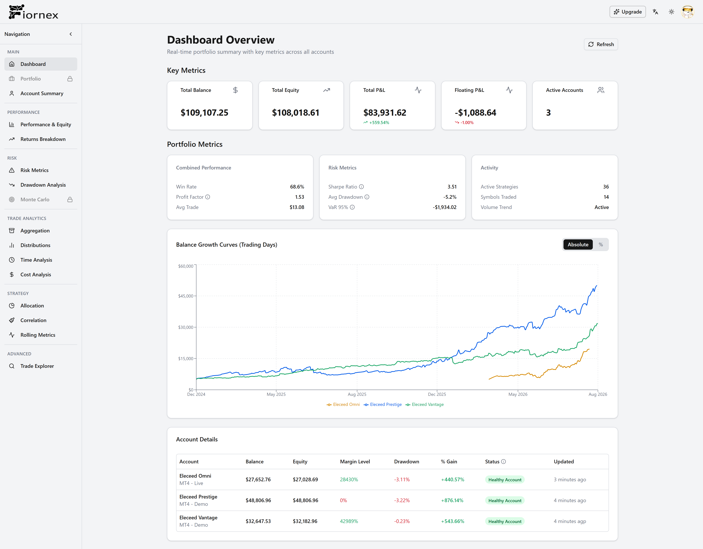
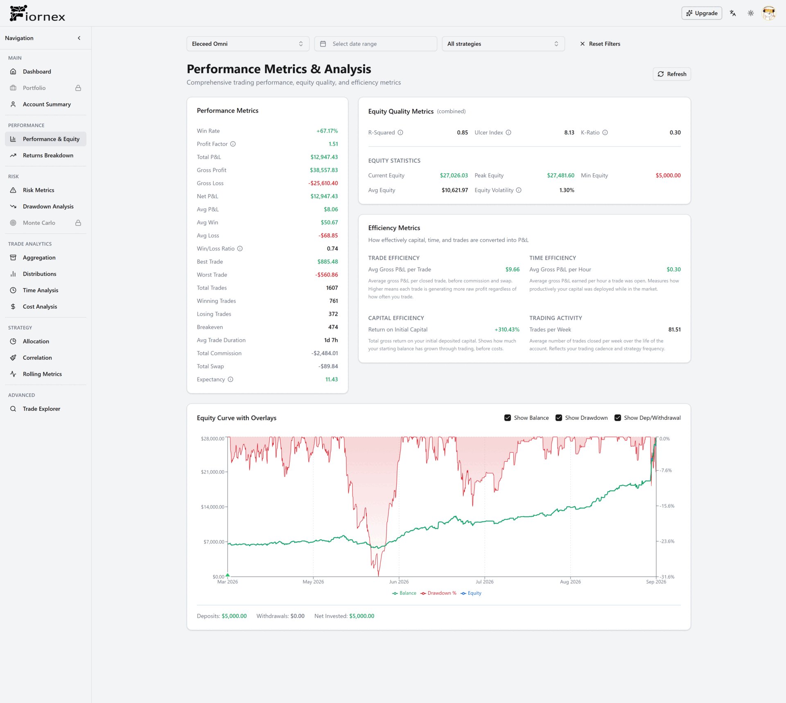
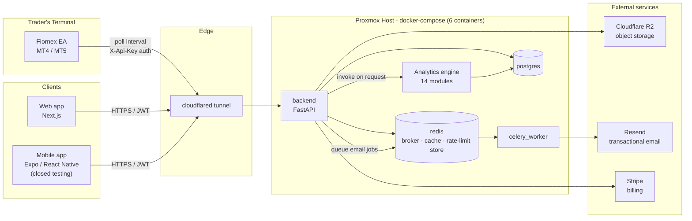
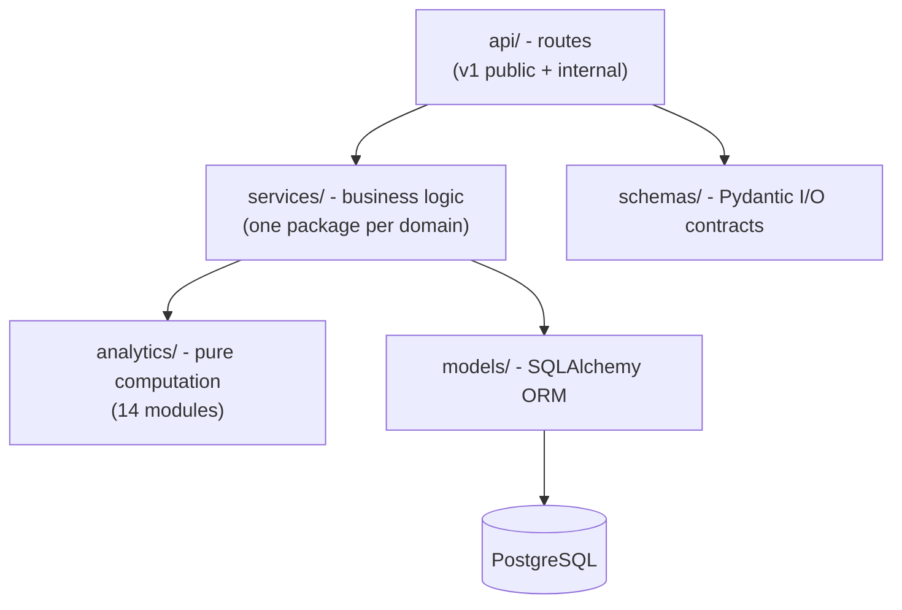
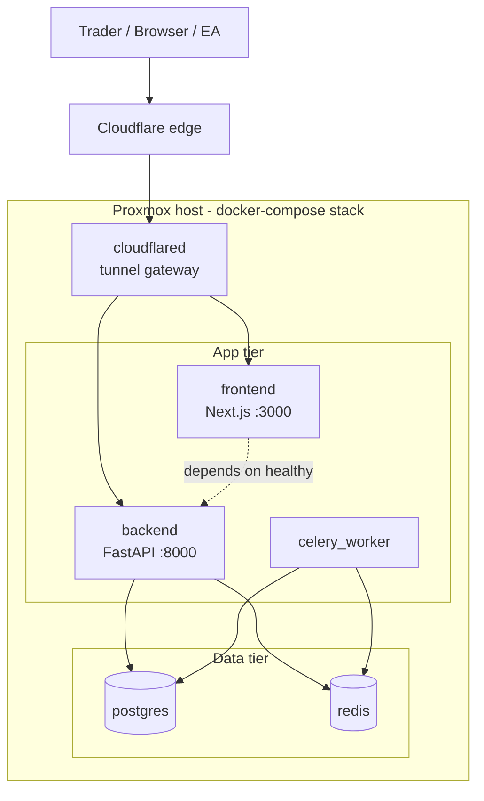

  

  

  
  
  
  
  
  

> **Note:** This is a public architecture overview, not the source repository. The codebase is private; this document exists to explain how the system is built and why. No proprietary logic, credentials or business data are included.

---

## What it does

Fiornex is comparable in spirit to MyFXBook, positioned as an institutional-grade analytics layer for individual trading accounts: a trader connects one or more live MT4/MT5 accounts, and the platform continuously ingests trade and account data to produce fund-style analytics (drawdown/recovery curves, risk telemetry (Sharpe, Sortino, Calmar, VaR/ES), cost & execution drag, correlation matrices, time/session breakdowns, and portfolio-level rebalancing suggestions) across **14 analytics modules**, without the trader having to compute any of it themselves.

Free tier gets the core analytics suite on a single connected account, forever, no card required. Paid tiers unlock multiple linked accounts, portfolio-level aggregation, and Pro-only modules (e.g. multi-account rebalancing). Users can also publish a [**public, read-only performance link**](https://fiornex.com/p/eleceed-omni) with full control over which metrics are visible - no login required for viewers.

## Screenshots

  Dashboard page: 
  

  Analytic pages carousell: 
  

---

## System overview

**How data moves, end to end:**

1. A lightweight **Expert Advisor (EA)**, written for both MT4 and MT5, is installed on the trader's terminal and authenticates to the backend with a per-account API key.
2. On a polling interval, the EA pushes account state and trade history to dedicated `internal/ea` ingestion endpoints.
3. The backend persists this to **PostgreSQL** and invalidates the relevant Redis cache entries for that account.
4. When a user views their dashboard, the **analytics engine** is invoked on demand: it reads trade/account data (cached in Redis where possible to avoid recomputation on every request) and returns computed metrics.
5. Web and mobile clients talk to the same FastAPI backend, authenticated via JWT (email/password or Google OAuth).
6. Everything sits behind a **Cloudflare Tunnel**, so the Proxmox host serving the Docker Compose stack has no directly exposed public IP.
---

## Backend architecture

The backend is a modular FastAPI application, structured around a strict separation between **API surface**, **service/business logic**, and **the analytics engine** itself.

**Route layer (`api/`)** is split into:
- `v1/` - versioned public API surface: accounts, analytics, auth, billing, portfolio, users, support, downloads
- `internal/` - endpoints not part of the public API contract: EA ingestion, admin billing tools, sitemap/SEO generation, system health
**Service layer (`services/`)** mirrors the route structure one level deeper - each domain (`accounts`, `analytics`, `auth`, `billing`, `ea`, `portfolio`, `users`, ...) owns its own service module(s), keeping routes thin and logic testable independently of HTTP.

**Analytics engine (`analytics/`)** is deliberately kept separate from `services/` - it's a computation layer with no framework or DB dependency of its own; services call into it and pass/receive plain data structures. It currently spans **14 analytics modules**, exposed through **11 grouped API route sets**:

| Domain area | Modules |
|---|---|
| Risk & performance | Risk telemetry (Sharpe, Sortino, Calmar, VaR/ES), drawdown analytics, rolling performance |
| Execution & drag | Cost & drag analysis, correlation matrix, time/session analysis |
| Portfolio & Pro | Multi-account aggregation, allocation, rebalancing suggestions |
| Behaviour | Trade-level analysis, streaks, histogram distributions |

**Data model highlights:**
- A user can link **multiple trading accounts** (limit gated by subscription tier)
- `portfolio` aggregates analytics across a user's linked accounts
- `portfolio_visibility` controls field-level masking on public portfolio pages (a user can publish a public view while hiding specific figures)
- `follow` exists in the schema for future social features (following other public portfolios) - present in the data model, not yet exposed in the product
**Async workloads (Celery + Redis):** Redis is a single instance serving three distinct roles - Celery's message broker, the rate-limiter's storage backend, and cache-aside storage for expensive-to-rebuild account data (snapshots/trades, invalidated explicitly on write rather than relying on TTL alone). Celery itself currently handles one class of work: **transactional email** (verification, password reset, welcome, email-change confirmation, support notifications) sent via Resend, with automatic retry on transient failures. It's intentionally run broker-only, with no result backend, since fire-and-forget email delivery doesn't need task results tracked.

**Rate limiting** is Redis-backed (required once the app runs multiple worker processes) and identity-aware rather than purely IP-based: authenticated users are limited per-user via their JWT, EA traffic is limited per-account via a hash of their API key (so multiple trading accounts behind one shared IP don't share a bucket), and everything else falls back to per-IP.

**Migrations** are managed with Alembic against PostgreSQL, with a linear, reviewed migration history rather than squashed/rebased revisions.

---

## Frontend architecture

**Web** - Next.js (App Router) + TypeScript, internationalized (9 languages), with:
- A typed API client layer (`api/endpoints` + `api/services`) mirroring the backend's domain boundaries 1:1
- A component system built on top of shadcn/ui primitives, layered with domain-specific chart, table, and card components
- MDX-based in-app documentation (connect account / configure portfolio / install EA guides, per-language)
- Public, unauthenticated routes for shared portfolio pages, separate from the authenticated app shell
**Mobile** - Expo / React Native, currently in closed testing pre-launch. Shares the same conceptual API/service/hook layering as web (`api/services`, `hooks/`, typed DTOs) so backend contract changes propagate predictably to both clients.
 
Both clients consume the same versioned FastAPI backend - no client-specific backend endpoints.

---

## Infrastructure & deployment

- **Deployment:** self-hosted on **Proxmox**, six containers via **Docker Compose** - `postgres`, `redis`, `celery_worker`, `backend`, `frontend`, `cloudflared` - with healthcheck-gated startup ordering (backend won't start until Postgres/Redis are healthy; frontend won't start until the backend health endpoint responds; the worker waits on both Postgres and Redis)
- **Networking:** no reverse proxy in front of the app containers - `cloudflared` connects outbound to Cloudflare's edge and routes directly to the `frontend` and `backend` containers by Docker service name; no inbound ports are opened on the host
- **Storage:** Cloudflare R2 (S3-compatible, via boto3) for static assets - user profile pictures and email-template imagery - trade/account data stays in Postgres, never in object storage
- **Payments:** Stripe for subscription billing, with webhook-driven state sync
- **Email:** Resend for all transactional email, dispatched asynchronously via Celery
- **Release process:** currently manual - pull + rebuild on the host; no CI/CD pipeline or automated test suite yet (noted here deliberately, not glossed over)
---

## Stack summary

| Layer | Technology |
|---|---|
| Backend framework | FastAPI (Python) |
| Database | PostgreSQL + SQLAlchemy + Alembic |
| Cache / broker / rate-limit store | Redis |
| Async tasks | Celery |
| Web frontend | Next.js, TypeScript, shadcn/ui |
| Mobile | Expo / React Native |
| Object storage | Cloudflare R2 |
| Transactional email | Resend |
| Payments | Stripe |
| Trading integration | Custom MT4/MT5 Expert Advisor |
| Deployment | Docker Compose on Proxmox, behind Cloudflare Tunnel |

---